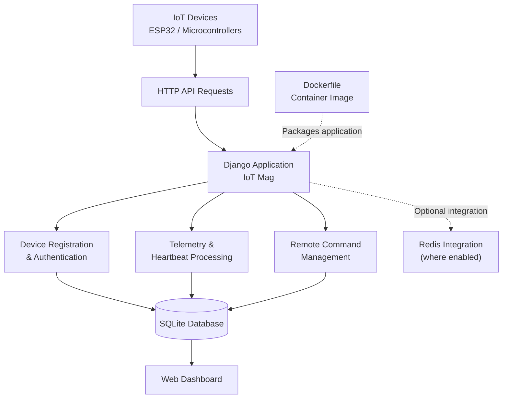

# IoT Mag — IoT Device Management and Control

**A Django-based platform for IoT device registration, authentication, telemetry ingestion, health monitoring, and remote command management.**

[](https://github.com/httpsanjay/IoTMag-Iot-Device-Managemnet-and-Control/stargazers)
[](https://github.com/httpsanjay/IoTMag-Iot-Device-Managemnet-and-Control/forks)
[](https://github.com/httpsanjay/IoTMag-Iot-Device-Managemnet-and-Control/issues)
[](https://github.com/httpsanjay/IoTMag-Iot-Device-Managemnet-and-Control/commits/main)
[](https://www.python.org/)
[](https://www.djangoproject.com/)
[](https://www.sqlite.org/)
[](https://www.docker.com/)

---

## Overview

IoT Mag is a Django-based IoT device management platform designed to provide a centralized backend for connected hardware.

IoT devices such as ESP32 microcontrollers can operate remotely, collect sensor readings, report operational health, and receive commands. Managing these devices individually becomes difficult as the number of devices grows.

IoT Mag addresses this challenge through a web dashboard and HTTP APIs that bring device registration, authentication, telemetry collection, health monitoring, and command management into one application.

The project focuses on the backend infrastructure required to connect embedded devices with a centralized web application.

### Key Highlights

- Device registration and verification.
- Token-based device authentication.
- Periodic heartbeat and health monitoring.
- Centralized telemetry ingestion.
- Remote command management and device-side polling.
- Django-powered web dashboard.
- SQLite database for the current default configuration.
- Redis integration for supported application functionality.
- Docker image build and execution using a `Dockerfile`.

## Table of Contents

- [Features](#features)
- [Screenshots](#screenshots)
- [Architecture](#architecture)
- [Technology Stack](#technology-stack)
- [Getting Started](#getting-started)
- [Running with Docker](#running-with-docker)
- [Configuration](#configuration)
- [Device Communication Workflow](#device-communication-workflow)
- [Project Structure](#project-structure)
- [Testing](#testing)
- [Security Considerations](#security-considerations)
- [Roadmap](#roadmap)
- [Contributing](#contributing)
- [License](#license)
- [Author](#author)

## Features

### 1. Device Registration and Authentication

IoT Mag provides a registration and authentication workflow for connected devices.

- Register devices with the platform.
- Verify device identity through the registration workflow.
- Associate devices with individual access credentials.
- Authenticate requests to protected device endpoints.

### 2. Telemetry Ingestion

Collect and store data reported by connected devices.

- Receive sensor readings and device telemetry through HTTP APIs.
- Associate incoming data with registered devices.
- Persist telemetry for subsequent inspection.
- Support microcontroller-based projects that communicate over HTTP.

### 3. Heartbeat and Health Monitoring

Monitor device communication and operational status.

- Receive periodic heartbeat requests.
- Record device activity and last-seen information.
- Track reported device health.
- Help identify devices that have stopped communicating.

Online status depends on the implemented heartbeat logic and the application's configured timeout behavior.

### 4. Remote Command Management

Manage commands from the centralized dashboard.

- Create commands for registered devices.
- Associate commands with their target devices.
- Allow devices to poll the backend for pending commands.
- Track command states and execution results where supported.

Command execution depends on device connectivity, polling intervals, and the device firmware's ability to process the requested operation.

### 5. Device Management Dashboard

The web interface provides a centralized view of the platform.

- View registered devices and dashboard information.
- Inspect device configuration.
- Review and manage commands.
- Access available telemetry views.
- Manage devices through the existing web interface.

### 6. Containerized Execution

IoT Mag includes a Dockerfile for building and running the Django application in a container.

- Build a container image from the project source.
- Run the application in an isolated environment.
- Use the same application image across compatible environments.
- Simplify deployment without requiring a manually configured Python environment on the host.

## Screenshots

### API Workflow


### Dashboard


### Command Management


### Device Configuration

<table>
  <tr>
    <td width="50%" align="center">
      <strong>Device Configuration — View 1</strong><br><br>
      
    </td>
    <td width="50%" align="center">
      <strong>Device Configuration — View 2</strong><br><br>
      
    </td>
  </tr>
</table>

## Architecture

IoT Mag follows a device-to-backend communication architecture. Connected hardware communicates with the Django application through HTTP APIs, and the application handles authentication, device operations, and data persistence.



The diagram illustrates the logical architecture. Redis is shown as an optional integration because not all Redis-related functionality is currently enabled. Docker is used to package the application and does not require Docker Compose.

### Component Responsibilities

| Component | Responsibility |
|---|---|
| IoT devices | Send telemetry, heartbeat information, and command-related requests |
| Django application | Handle application logic, authentication, and HTTP endpoints |
| SQLite | Provide the default database for the current configuration |
| Redis | Support related application functionality where enabled |
| Web dashboard | Provide a device and command management interface |
| Dockerfile | Define how the application container image is built |

## Technology Stack

| Technology | Purpose |
|---|---|
| Python | Backend programming language |
| Django | Web framework and application logic |
| Django REST Framework | REST API development |
| SQLite | Current default database |
| Redis | Optional caching or related integration where enabled |
| django-redis | Django–Redis integration |
| HTTP | Communication between connected devices and the backend |
| Docker | Containerized application execution |

**Database note:** The current default configuration uses SQLite. PostgreSQL configuration has been commented out and is not required for the standard setup described in this README.

**Redis note:** Redis-related dependencies and code exist in the project, but some integrations have been commented out. A running Redis server is not assumed to be required for the default setup.

## Getting Started

### Prerequisites

For local development, you need:

- Git
- Python compatible with the project's installed dependencies
- A terminal or command prompt

### 1. Clone the Repository

```bash
git clone https://github.com/httpsanjay/IoTMag-Iot-Device-Managemnet-and-Control.git

cd IoTMag-Iot-Device-Managemnet-and-Control
```

### 2. Create a Virtual Environment

**Windows — PowerShell:**

```powershell
python -m venv venv
.\venv\Scripts\Activate.ps1
```

**Windows — Command Prompt:**

```bat
python -m venv venv
venv\Scripts\activate.bat
```

**Linux / macOS:**

```bash
python3 -m venv venv
source venv/bin/activate
```

### 3. Install Dependencies

```bash
python -m pip install --upgrade pip
pip install -r requirements.txt
```

### 4. Apply Database Migrations

The current default Django configuration uses SQLite.

Run the migrations to create the required database tables:

```bash
python manage.py migrate
```

Django creates the SQLite database file at the location specified by the project's database configuration.

### 5. Create an Administrator Account

To access Django's administrative interface, create a superuser:

```bash
python manage.py createsuperuser
```

Follow the prompts to configure the account.

### 6. Start the Development Server

```bash
python manage.py runserver
```

Open the application in your browser:

**http://127.0.0.1:8000/**

The actual pages available depend on the application's URL configuration.

### 7. Run the Application

After starting the server, explore the dashboard, inspect the device management interface, and use the documented API workflow to test device communication.

Use test devices and dummy data while experimenting.

## Running with Docker

IoT Mag includes a `Dockerfile` that defines the application image. Docker Compose is not required for this workflow.

### 1. Build the Image

Run this command from the repository root:

```bash
docker build -t iotmag .
```

### 2. Start the Container

If the Dockerfile starts the Django application on port `8000` and binds it to `0.0.0.0`, run:

```bash
docker run -d --name iotmag-app -p 8000:8000 iotmag
```

Open:

**http://localhost:8000/**

The host port mapping must match the port configured by the Dockerfile's startup command.

### 3. Inspect Container Logs

```bash
docker logs -f iotmag-app
```

### 4. Stop the Container

```bash
docker stop iotmag-app
```

To remove the stopped container:

```bash
docker rm iotmag-app
```

### SQLite Persistence in Docker

SQLite stores data in a local database file. If the database is stored inside the container filesystem, deleting the container can cause the database to be lost.

For persistent deployments, configure an appropriate volume mount for the directory containing the SQLite database. Ensure the container has the required read and write permissions.

Database migrations and administrator creation must also be handled according to the application's startup and deployment configuration.

## Configuration

Before running the application in a new environment, check the Django settings and Dockerfile for the following:

| Configuration | Purpose |
|---|---|
| Django secret key | Application cryptographic signing |
| Debug mode | Development and production behavior |
| Allowed hosts | Permitted hostnames |
| Database settings | SQLite database location |
| Redis settings | Relevant only to enabled Redis functionality |
| Device credentials | Authentication for device API requests |
| Container port | Port used by the Django application |

Use environment variables or an appropriate secrets mechanism for sensitive production configuration. Never commit production credentials or device access tokens to Git.

## Device Communication Workflow

A typical IoT Mag device interaction follows this sequence:

1. **Registration:** The device initiates registration with the backend.
2. **Verification:** The backend processes the device verification workflow.
3. **Authentication:** The device uses its assigned credentials to authenticate protected requests.
4. **Heartbeat:** The device periodically reports its activity.
5. **Telemetry:** The device submits sensor readings or operational data.
6. **Command polling:** The device requests pending commands from the backend.
7. **Execution reporting:** The device reports command results where the implemented workflow supports it.

The actual endpoint paths, HTTP methods, authentication headers, and JSON request and response formats are determined by the current API implementation.

For the exact supported requests, consult the API workflow screenshot and the API documentation available in the project.

## Project Structure

```text
IoTMag-Iot-Device-Managemnet-and-Control/
├── IotMag/
│   ├── __init__.py
│   ├── asgi.py
│   ├── settings.py
│   ├── urls.py
│   └── wsgi.py
├── core/
│   ├── backends/
│   ├── migrations/
│   ├── templates/
│   ├── admin.py
│   ├── helper.py
│   ├── models.py
│   ├── tests.py
│   ├── urls.py
│   └── views.py
├── device/
│   ├── migrations/
│   ├── admin.py
│   ├── models.py
│   ├── tests.py
│   ├── urls.py
│   └── views.py
├── Demo_images/
│   ├── API_Workflow.png
│   ├── Dashboard.png
│   ├── All_Commands.png
│   ├── device_config1.png
│   └── device_config2.png
├── Dockerfile
├── LICENSE
├── CONTRIBUTING.md
├── CODE_OF_CONDUCT.md
├── manage.py
└── requirements.txt
```

### Main Modules

- **`IotMag/`** — Project-level settings, root URL configuration, and Django application entry points.
- **`core/`** — Core application logic, supporting utilities, templates, and web views.
- **`device/`** — Device-related models, endpoints, migrations, and tests.
- **`Demo_images/`** — Screenshots and visual documentation.
- **`Dockerfile`** — Instructions for building the container image.
- **`requirements.txt`** — Python dependencies.

The structure above highlights the primary components rather than listing every migration and template file.

## Testing

IoT Mag includes Django test modules for core and device functionality.

Run the existing test suite from the repository root:

```bash
python manage.py test
```

To run tests for an individual application:

```bash
python manage.py test core
python manage.py test device
```

The actual coverage and reliability of each workflow depend on the tests implemented in the current repository.

## Security Considerations

IoT Mag is intended for IoT development, experimentation, and backend learning.

Before deploying an instance to a public environment:

- Use HTTPS for device-to-server communication.
- Protect device credentials and rotate compromised tokens.
- Validate incoming requests and authenticate protected endpoints.
- Configure Django's production security settings.
- Restrict access to administrative and device-management interfaces.
- Keep secret keys and credentials out of source control.
- Validate telemetry payloads and command requests.
- Apply appropriate request limits and logging.
- Protect SQLite database files and back up important data.
- Verify authorization boundaries between devices and users.

A successful local deployment does not, by itself, establish that the application is production-hardened.

## Roadmap

Potential areas for future improvement:

- [ ] Expand automated tests for device registration and authentication.
- [ ] Improve API documentation with request and response examples.
- [ ] Enhance telemetry filtering and visualization.
- [ ] Improve device-health reporting and monitoring.
- [ ] Strengthen command execution tracking and error handling.
- [ ] Add structured logging and operational monitoring.
- [ ] Document production deployment and database backup procedures.
- [ ] Evaluate application behavior with simulated devices and telemetry workloads.

These items represent potential improvements, not claims that the features have already been implemented.

## Contributing

Contributions, bug reports, and suggestions are welcome.

1. Fork the repository.
2. Clone your fork.
3. Create a feature branch.
4. Implement and test your changes.
5. Commit your changes with a descriptive message.
6. Push the branch to your fork.
7. Open a pull request describing your changes.

For additional guidelines, see [`CONTRIBUTING.md`](CONTRIBUTING.md).

Please do not commit secrets, production credentials, personal information, or real device tokens.

## License

See the [`LICENSE`](LICENSE) file in this repository for the applicable license and usage terms.

## Author

**Sanjay**

Interested in IoT systems, embedded development, backend engineering, and connected-device infrastructure.

- **GitHub:** [@httpsanjay](https://github.com/httpsanjay)
- **Repository:** [IoT Mag — IoT Device Management and Control](https://github.com/httpsanjay/IoTMag-Iot-Device-Managemnet-and-Control)

If you find this project useful, consider giving the repository a star or contributing improvements.

---

<p align="center">
  Built to explore the engineering behind connected devices and IoT infrastructure.
</p>
