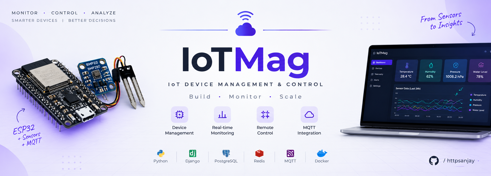
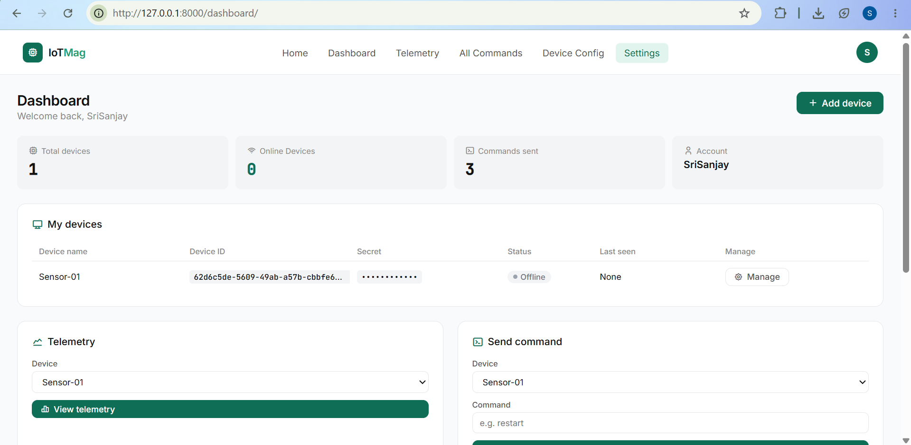
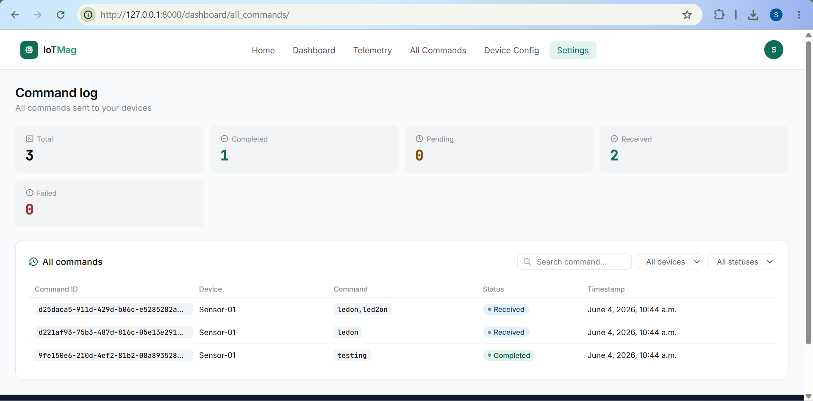
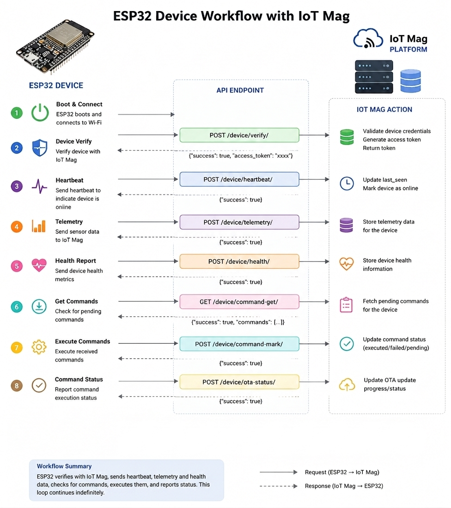
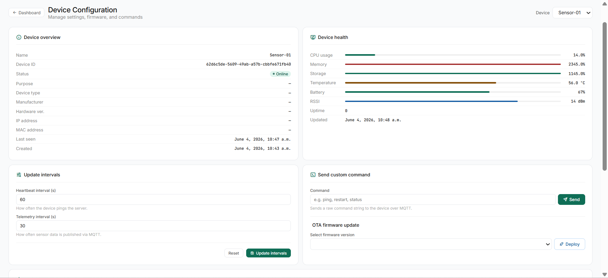
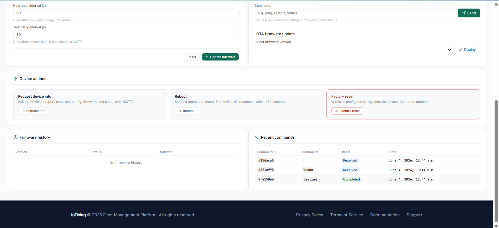
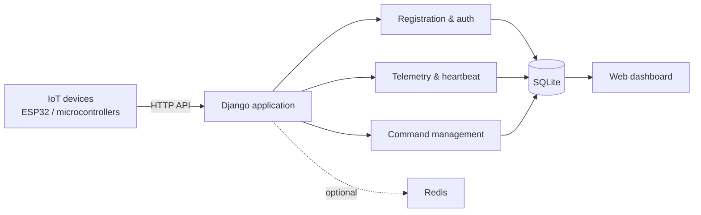
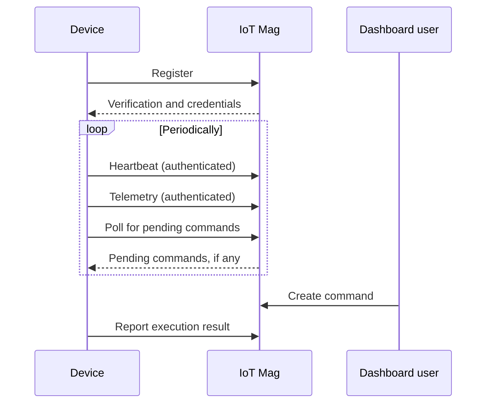

<div align="center">

<p align="center">
  
</p>


# IoT Mag

**A Django backend and dashboard for registering, authenticating, monitoring, and commanding IoT devices.**

[](https://www.python.org/)
[](https://www.djangoproject.com/)
[](https://www.sqlite.org/)
[](https://www.docker.com/)
[](https://github.com/httpsanjay/IoTMag-Iot-Device-Managemnet-and-Control/commits/main)
[](https://github.com/httpsanjay/IoTMag-Iot-Device-Managemnet-and-Control/stargazers)
[](https://github.com/httpsanjay/IoTMag-Iot-Device-Managemnet-and-Control/issues)

[Quick Start](#quick-start) · [Features](#features) · [Architecture](#architecture) · [Docker](#running-with-docker) · [Security](#security-considerations) · [Roadmap](#roadmap)

</div>

---

## Overview

Remote devices such as ESP32 boards are easy to build and hard to manage at scale. IoT Mag gives them a single backend: devices register, authenticate with a token, send heartbeats and telemetry over HTTP, and poll for commands, while you manage everything from a web dashboard.

It is built for IoT development, experimentation, and learning backend engineering for connected hardware.

## Features

| Area | What it does |
|---|---|
| **Registration & auth** | Register devices, verify identity, issue per-device credentials, and authenticate requests to protected endpoints. |
| **Telemetry** | Receive sensor readings over HTTP, link them to the sending device, and store them for later inspection. |
| **Heartbeat & health** | Record last-seen activity and reported health so you can spot devices that have gone quiet. |
| **Remote commands** | Create commands for a device from the dashboard; devices poll for pending commands and can report results. |
| **Dashboard** | View devices, inspect configuration, review commands, and browse telemetry in one place. |
| **Containerized** | Build and run the app from the included `Dockerfile`. |

> **Note:** Online status depends on the heartbeat logic and timeout configuration. Command delivery depends on device connectivity, polling interval, and what the device firmware can execute.

## Screenshots


| Command Management | API Workflow |
|---|---|
|  |  |

| Device Configuration (1) | Device Configuration (2) |
|---|---|
|  |  |

## Quick Start

```bash
git clone https://github.com/httpsanjay/IoTMag-Iot-Device-Managemnet-and-Control.git
cd IoTMag-Iot-Device-Managemnet-and-Control

python3 -m venv venv && source venv/bin/activate   # Windows: venv\Scripts\activate
pip install -r requirements.txt

python manage.py migrate
python manage.py createsuperuser
python manage.py runserver
```

Open **http://127.0.0.1:8000/**. Use test devices and dummy data while experimenting.

<details>
<summary>Windows activation commands</summary>

**PowerShell**

```powershell
python -m venv venv
.\venv\Scripts\Activate.ps1
```

**Command Prompt**

```bat
python -m venv venv
venv\Scripts\activate.bat
```

</details>

**Prerequisites:** Git and a Python version compatible with the dependencies in `requirements.txt`.

## Architecture

Devices talk to the Django application over HTTP. The application handles authentication, device operations, and persistence.



Redis is shown as optional: some Redis-related code and dependencies exist, but parts are commented out, and a running Redis server is not required for the default setup.

### Device lifecycle



Exact endpoint paths, HTTP methods, headers, and JSON formats are defined by the current API implementation. See the API workflow screenshot above and the API documentation in the project.

### Tech stack

| Technology | Purpose |
|---|---|
| Python, Django | Backend and web framework |
| Django REST Framework | REST API |
| SQLite | Default database |
| Redis, django-redis | Optional caching and related integrations |
| Docker | Containerized execution |

PostgreSQL configuration is commented out and not needed for the standard setup.

## Running with Docker

Docker Compose is not required. Build and run from the repository root:

```bash
docker build -t iotmag .
docker run -d --name iotmag-app -p 8000:8000 iotmag
```

Then open **http://localhost:8000/**. The host port mapping must match the port the Dockerfile's startup command uses (and the app must bind to `0.0.0.0`).

```bash
docker logs -f iotmag-app     # view logs
docker stop iotmag-app        # stop
docker rm iotmag-app          # remove
```

**SQLite persistence:** if the database file lives inside the container filesystem, removing the container deletes your data. For anything you want to keep, mount a volume over the directory that holds the database and make sure it is writable. Migrations and admin creation must also be handled by your startup configuration.

## Configuration

Review the Django settings and Dockerfile before running in a new environment:

| Setting | Why it matters |
|---|---|
| Secret key | Cryptographic signing |
| Debug mode | Must be off outside development |
| Allowed hosts | Which hostnames the app serves |
| Database | Location of the SQLite file |
| Redis | Only relevant if Redis features are enabled |
| Device credentials | Authentication for device API calls |
| Container port | Port the app listens on in Docker |

Use environment variables or a secrets manager for production values. Never commit credentials or device tokens to Git.

## Project Structure

```text
IoTMag-Iot-Device-Managemnet-and-Control/
├── IotMag/          # Project settings, root URLs, ASGI/WSGI entry points
├── core/            # Core logic, helpers, auth backends, templates, web views
├── device/          # Device models, endpoints, migrations, tests
├── Demo_images/     # Screenshots
├── Dockerfile
├── manage.py
├── requirements.txt
├── CONTRIBUTING.md
├── CODE_OF_CONDUCT.md
└── LICENSE
```

Migrations and template files are omitted for brevity.

## Testing

```bash
python manage.py test           # everything
python manage.py test core      # core app only
python manage.py test device    # device app only
```

Coverage depends on the tests currently in the repository; expanding them is on the roadmap.

## Security Considerations

IoT Mag is meant for development and experimentation. A successful local run does not mean it is production-hardened. Before exposing an instance publicly:

- Serve everything over HTTPS, including device-to-server traffic.
- Protect device credentials and rotate any that are compromised.
- Authenticate protected endpoints and verify authorization boundaries between devices and users.
- Validate telemetry payloads and command requests, and apply rate limits.
- Turn on Django's production security settings and restrict access to admin and device-management pages.
- Keep secret keys and tokens out of source control.
- Back up and protect the SQLite database file.
- Add structured logging so you can audit activity.

## Roadmap

- [ ] MQTT Integration
- [ ] Improve telemetry visualization
- [ ] Enhance device health monitoring
- [ ] Export logs and activity records
- [ ] Add structured logging
- [ ] Document deployment and backups
- [ ] Test with simulated devices and high workloads

## Contributing

Contributions, bug reports, and suggestions are welcome.

1. Fork the repository and create a feature branch.
2. Make and test your changes.
3. Commit with a descriptive message and open a pull request.

See [`CONTRIBUTING.md`](CONTRIBUTING.md) for details. Please don't commit secrets, personal information, or real device tokens.

## License

See [`LICENSE`](LICENSE) for terms.

## Author

**Sanjay** · [@httpsanjay](https://github.com/httpsanjay)

Interested in IoT systems, embedded development, backend engineering, and connected-device infrastructure.

If this project is useful to you, a star is appreciated.
