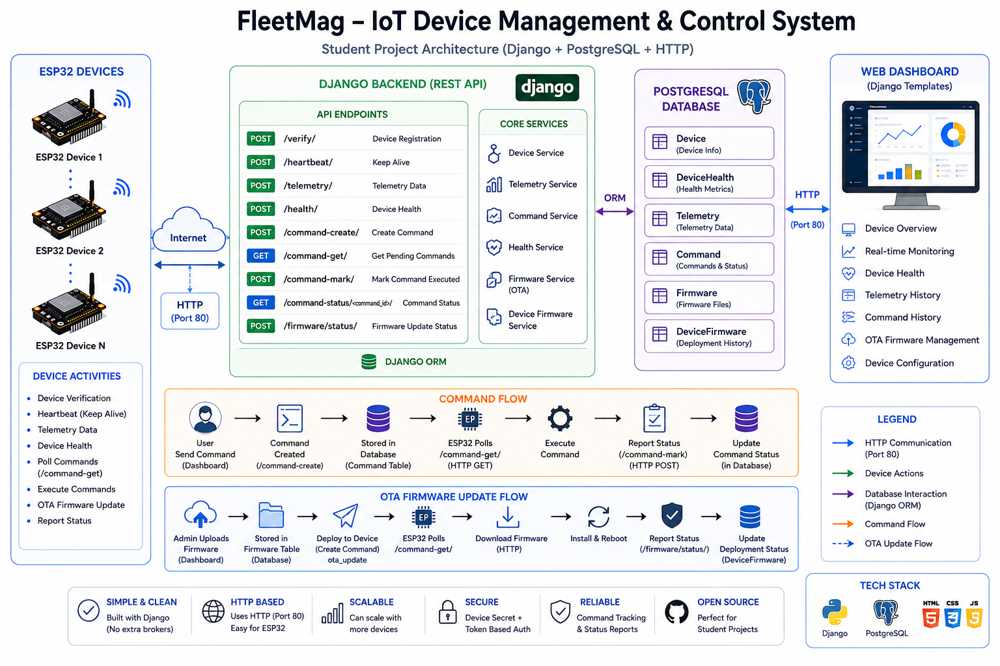

# IoTMag-Iot-Device-Managemnet-and-Control

> Centralized Django platform for IoT device telemetry, health monitoring, and remote control.

    

## 📑 Table of Contents

- [Description](#description)
- [Key Features](#key-features)
- [Use Cases](#use-cases)
- [Screenshots](#screenshots)
- [Tech Stack](#tech-stack)
- [Architecture](#architecture)
- [Quick Start](#quick-start)
- [Key Dependencies](#key-dependencies)
- [Project Structure](#project-structure)
- [Development Setup](#development-setup)
- [Deployment](#deployment)
- [Contributors](#contributors)
- [Contributing](#contributing)
- [License](#license)

## 📝 Description

IoT Mag is a Django-based backend platform designed to manage and monitor connected hardware such as ESP32 devices. It addresses the challenge of coordinating distributed microcontrollers by providing structured HTTP endpoints to handle device registration, health monitoring, and incoming telemetry data.

The architecture connects embedded devices to a central web service using token-based HTTP authentication. Microcontrollers transmit periodic heartbeats, status reports, and sensor telemetry back to the server, while simultaneously polling for pending commands created and managed within the platform.

Configured for containerized deployment with Docker and Docker Compose, this system serves developers prototyping custom IoT deployments, learning microcontroller-to-cloud workflows, and managing remote device operations.

## ✨ Key Features

- **🔐 Device Verification and Authentication** — Verifies hardware identity and issues dedicated access tokens to secure device-to-backend communication.
- **💓 Heartbeat and Health Monitoring** — Receives periodic heartbeat pings and health reports to track the operational status of connected devices.
- **📊 Telemetry Ingestion Pipeline** — Collects and persists sensor and device telemetry over HTTP APIs for centralized monitoring.
- **📡 Remote Command Management** — Enables dispatching commands, allowing devices to poll pending tasks and confirm execution.
- **🐳 Dockerized Application Environment** — Includes Dockerfile and docker-compose configurations for running the backend and service dependencies in containers.

## 🎯 Use Cases

- Ingesting sensor telemetry and operational data from ESP32 microcontrollers over HTTP.
- Tracking uptime and connection health across a fleet of remote hardware nodes.
- Queuing and executing operational commands on field devices from a central web backend.
- Prototyping and experimenting with custom IoT backend architectures using Django.

## 📸 Screenshots





## 🛠️ Tech Stack

   

## 🏗️ Architecture

A high-level view of how the main pieces fit together:

## ⚡ Quick Start

```bash

# 1. Clone the repository
git clone https://github.com/httpsanjay/IoTMag-Iot-Device-Managemnet-and-Control.git

# 2. Create & activate a virtualenv
python -m venv venv && source venv/bin/activate

# 3. Install dependencies
pip install -r requirements.txt
```

## 📦 Key Dependencies

```
Django: 6.0.1
django-environ: 0.13.0
django-redis: 6.0.0
djangorestframework: 3.16.1
psycopg2-binary: 2.9.11
redis: 8.0.0
httpx: 0.28.1
gunicorn: 25.1.0
```

## 📁 Project Structure

```
.
├── CODE_OF_CONDUCT.md
├── CONTRIBUTING.md
├── Demo_images
│   ├── API_Workflow.png
│   ├── All_Commands.png
│   ├── Dashboard.png
│   ├── Overview.png
│   ├── device_config1.png
│   ├── device_config2.png
│   ├── index.png
│   ├── login.png
│   └── telemetry.png
├── Dockerfile
├── IotMag
│   ├── __init__.py
│   ├── asgi.py
│   ├── settings.py
│   ├── urls.py
│   └── wsgi.py
├── LICENSE
├── core
│   ├── __init__.py
│   ├── admin.py
│   ├── apps.py
│   ├── backends
│   │   └── email_backend.py
│   ├── helper.py
│   ├── migrations
│   │   ├── 0001_initial.py
│   │   └── __init__.py
│   ├── models.py
│   ├── templates
│   │   ├── account_settings.html
│   │   ├── all_commands.html
│   │   ├── api_docs.html
│   │   ├── base.html
│   │   ├── dashboard.html
│   │   ├── device_config.html
│   │   ├── error.html
│   │   ├── firmware_upload.html
│   │   ├── group_list.html
│   │   ├── index.html
│   │   ├── login.html
│   │   ├── password_reset.html
│   │   ├── signup.html
│   │   └── telemetry_page.html
│   ├── tests.py
│   ├── urls.py
│   └── views.py
├── device
│   ├── __init__.py
│   ├── admin.py
│   ├── apps.py
│   ├── migrations
│   │   ├── 0001_initial.py
│   │   ├── 0002_device_last_seen.py
│   │   ├── 0003_device_is_online.py
│   │   ├── 0004_remove_device_is_online_remove_device_last_seen.py
│   │   ├── 0005_device_last_seen.py
│   │   ├── 0006_alter_command_command_id.py
│   │   ├── 0007_firmware_device_device_type_device_hardware_version_and_more.py
│   │   ├── 0008_devicefirmware_created_at.py
│   │   ├── 0009_alter_device_access_token.py
│   │   ├── 0010_devicegroup_device_group.py
│   │   ├── 0011_devicegroup_number_of_devices.py
│   │   ├── 0012_remove_devicegroup_number_of_devices.py
│   │   └── __init__.py
│   ├── models.py
│   ├── tests.py
│   ├── urls.py
│   └── views.py
├── docker-compose.yml
├── images
│   ├── API_Workflow.png
│   ├── All_Commands.png
│   ├── Dashboard.png
│   ├── Overview.png
│   ├── device_config1.png
│   ├── device_config2.png
│   ├── index.png
│   ├── login.png
│   └── telemetry.png
├── manage.py
└── requirements.txt
```

## 🛠️ Development Setup

### Python
1. Install Python (v3.10+ recommended)
2. `python -m venv venv && source venv/bin/activate`  (Windows: `venv\Scripts\activate`)
3. `pip install -r requirements.txt`

### Docker
1. `docker build -t my-app .`
2. `docker run -p 3000:3000 my-app`

## 🚢 Deployment

### Docker
```bash
docker build -t iotmag-iot-device-managemnet-and-control .
docker run -p 3000:3000 iotmag-iot-device-managemnet-and-control
```

### Docker Compose
```bash
docker compose up -d
```

## 👥 Contributors

Thanks to everyone who has contributed to this project:

<p align="left">
<a href="https://github.com/httpsanjay" title="httpsanjay"></a>
</p>

[See the full list of contributors →](https://github.com/httpsanjay/IoTMag-Iot-Device-Managemnet-and-Control/graphs/contributors)

## 👥 Contributing

Contributions are welcome! Here's the standard flow:

1. **Fork** the repository
2. **Clone** your fork: `git clone https://github.com/httpsanjay/IoTMag-Iot-Device-Managemnet-and-Control.git`
3. **Branch**: `git checkout -b feature/your-feature`
4. **Commit**: `git commit -m 'feat: add some feature'`
5. **Push**: `git push origin feature/your-feature`
6. **Open** a pull request

Please follow the existing code style and include tests for new behavior where applicable.

## 📜 License

This project is licensed under the **LICENSE** License.

---

<div align="center">

[](https://readmebuddy.com)

<sub>Generate beautiful READMEs in seconds → <a href="https://readmebuddy.com">readmebuddy.com</a></sub>

</div>
